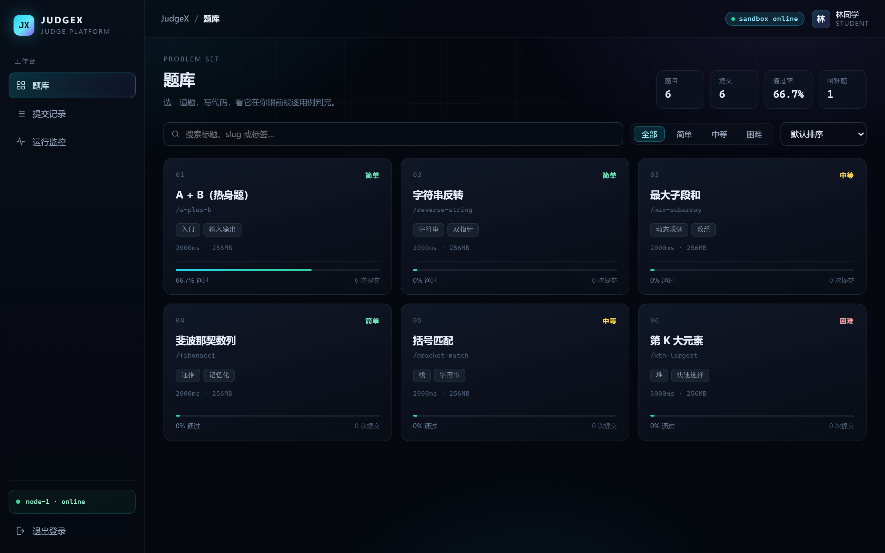
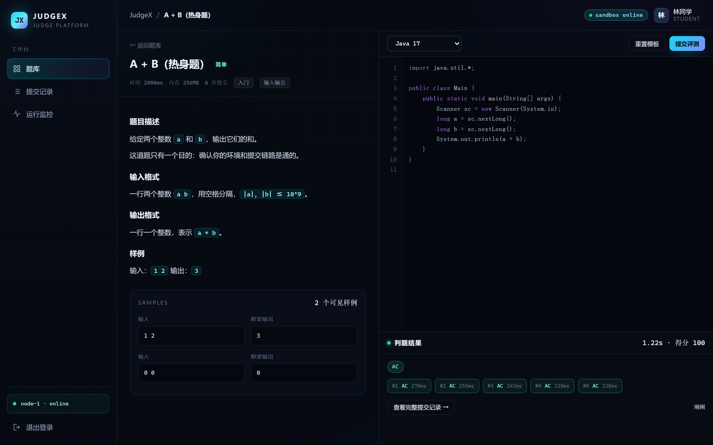
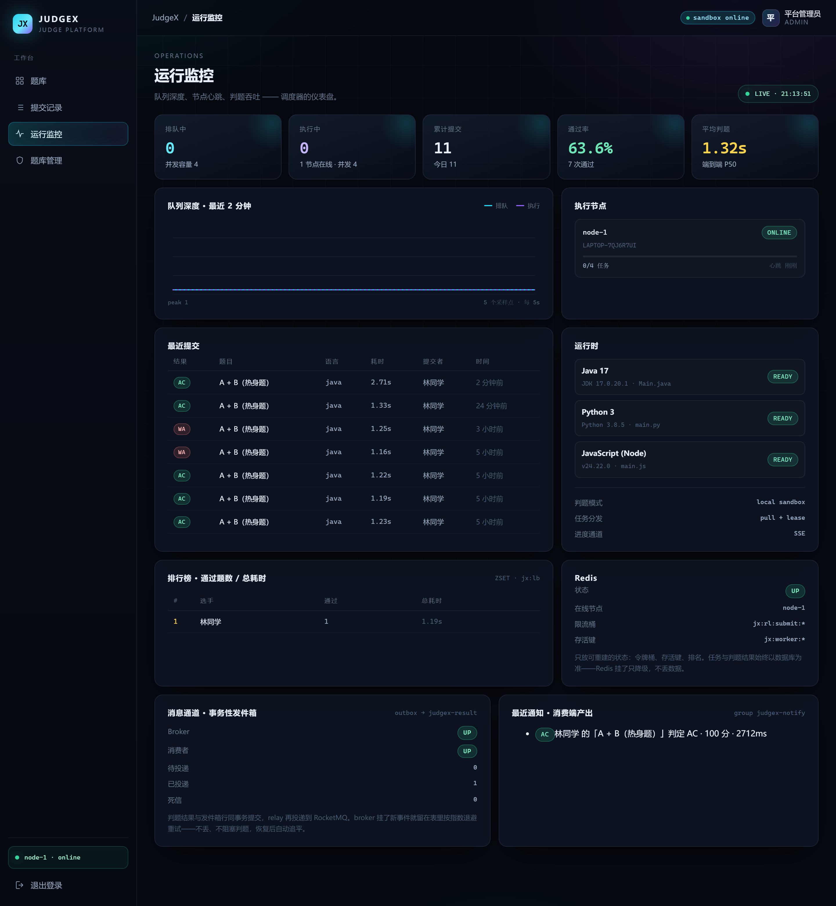
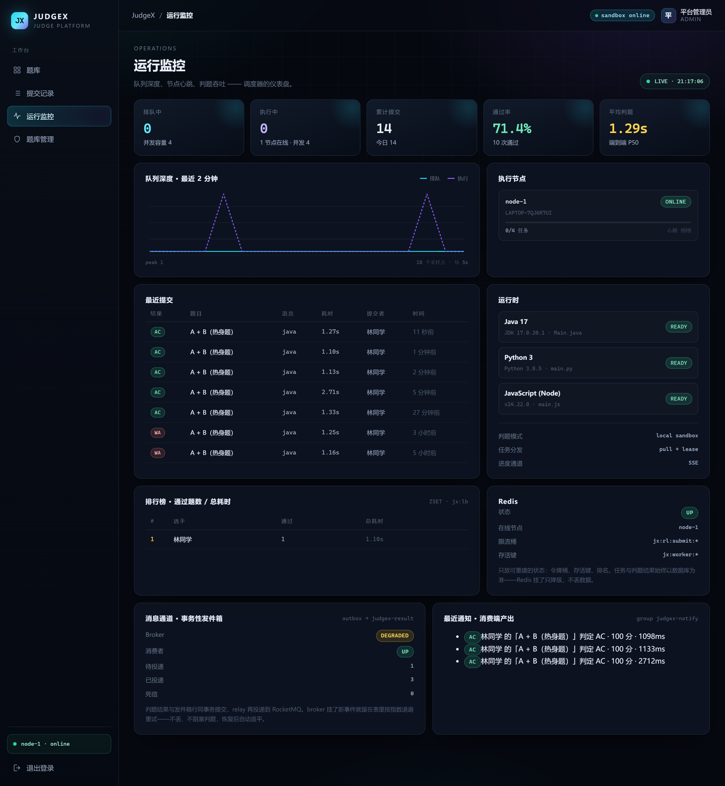

<div align="center">
  <h2>JudgeX</h2>

  <p>
    <a href="https://github.com/Xiangyfff/JudgeX/stargazers"></a>
    
    
    
    
    
    
    
    
    <a href="./LICENSE"></a>
  </p>
</div>

<div align="center">

一个把不可信代码关进沙箱的 <strong>在线判题平台</strong>。

判题失败从来不是"算错了"，而是"跑飞了""重复跑了""跑完没人知道"。

</div>

## 项目预览

**题库与进度**



**做题与逐用例判题**



**运行监控**



**故障降级**



用户登录后从题库选题，在右侧编辑器里写代码，提交后不用等待：每个测试点跑完就点亮一个，通常 1.2 秒内看到最终判定。监控台把队列深度、节点心跳、判题耗时和消息通道摊在同一页，停掉 broker 也不会挡住判题——事件留在发件箱里，broker 回来自己追平。

## 核心功能

判题系统的难点不在"运行代码"，而在运行的是**不可信代码**、以及跑它的机器**随时会挂**。JudgeX 的设计围绕这两件事展开，可以概括为四层能力。

### 🧱 不丢不重的任务调度

> 提交即落库，任务靠一条 CAS 抢，跑一半的机器挂了有人捡回来。

- **数据库即队列** — 提交记录与判题任务在同一事务写入，队列就是 `judge_tasks` 这张表，不额外引入队列中间件。
- **MQ 只提醒，不分配** — 入队后发一条"有活了"，Worker 醒来仍然要靠 CAS 去抢；消息丢了有 2 秒兜底轮询，broker 整个挂掉判题也照常跑。
- **CAS 认领** — 用一次条件更新把任务从 `QUEUED` 改成 `ASSIGNED`，affected rows 为 1 的 Worker 拿走任务，多实例部署也安全。
- **租约 + 延时闹钟** — 认领时定一个 30 秒的闹钟（租约 45 秒），闹钟回来发现租约还活着就按剩余时间续一个；Worker 真挂了，一个闹钟周期内就被捡回来，60 秒一次的全表扫描只当兜底。
- **三层幂等** — 请求幂等键拦重复点击，CAS 拦重复派发，终态守卫（`WHERE status <> 'DONE'`）拦"任务回收后迟到的结果"。

### 🔒 分层沙箱

> 先管住一定会发生的事：死循环、输出洪水、内存。

- **超时强杀** — 到点销毁整棵进程树，提交的代码 fork 出子进程也带得走。
- **输出截断** — stdout / stderr 各一个读取线程，累计超过 64KB 立刻杀进程判 `OLE`，避免子进程堵死在管道上假装超时。
- **资源与环境保护** — Java、Node 有堆上限；环境变量清空只留 `PATH`，`HOME` 与临时目录指向任务私有目录，跑完即删。
- **Linux 级隔离兜底** — 切到 Docker 后端后由 namespace、只读根与 `--pids-limit` 兜底；`local` 模式明确只做到进程级，防误伤不防恶意。

### 📡 看得见的判题过程

> 一次提交 1.2 秒，用户不该对着转圈猜。

- **逐用例推送** — 每跑完一个用例发一条 SSE，前端把 chip 依次点亮，不轮询。
- **快照 + 增量** — 断线重连先收当前全量结果再收增量，刷新页面不会永久丢一段。
- **运行指标** — 队列深度每 5 秒采样、节点心跳、端到端 P50、语言运行时探测，都落在监控台。

### 📤 三种消息，一条纪律

> 消息只负责提醒，真相永远在数据库里。

- **结果通知不能丢** — 终态与 outbox 行同事务提交，`event_key` 唯一索引兜底；Relay 每 400ms 领取到期行投递 RocketMQ。
- **派活和闹钟可以丢** — 这两类只做"叫醒"和"到点回来看一眼"：发送是异步的，broker 连不上就记一个丢包计数，绝不拖慢提交；消息没了有兜底轮询和安全扫描。
- **退避与死信** — 失败按 1s → 2s → 4s 退避（30s 封顶），6 次仍失败进死信表，留给人看。
- **消费幂等** — 通知表在提交号上有唯一索引，重复投递不会多出一条。
- **故障演练** — 本机全程关掉 broker：提交到 AC 从 0.6 秒退化到 2.5 秒（一个兜底周期），判题结果不受影响；手动催单接口 `POST /api/admin/judge/wake` 777ms 出结果。反过来接上 broker（RocketMQ 4.9.7）再测：通知 1 次投递成功（`SENT`，重试 0 次）、站内信落库、延时闹钟按级别回收租约、端到端 0.8～1.5 秒。

## 系统流程

```mermaid
sequenceDiagram
    autonumber
    actor User as 用户
    participant Web as Vue 工作台
    participant API as Spring Boot
    participant DB as MySQL
    participant Worker as 判题 Worker
    participant Box as 沙箱

    User->>Web: 写代码并提交
    Web->>API: 提交请求（带幂等键）
    API->>DB: 提交与任务同事务落库
    API-->>Web: 返回提交号，SSE 开始推送

    Worker->>DB: CAS 认领任务（租约 45s）
    Worker->>Box: 编译并逐个用例执行
    Box-->>Worker: 输出 / 超时 / 内存 / 溢出
    Worker->>DB: 用例结果落库（唯一索引兜底）
    Worker-->>Web: SSE 推送 case 事件
    Worker->>DB: 终态与 outbox 同一事务提交

    Note over DB,API: Relay 每 400ms 领取到期事件投递 RocketMQ，消费端落站内通知
```

## 技术栈

| 层次 | 技术 | 用途 |
| :--- | :--- | :--- |
| Web | Vue 3、Vite、TypeScript、SSE | 题库、编辑器、逐用例进度与监控台 |
| API | Java 17、Spring Boot 3.5.16、MyBatis 3.5 | 鉴权、提交、调度与 REST API |
| 执行 | ProcessBuilder、Docker | 编译运行与进程级隔离，两套沙箱共用一套接口 |
| 数据 | MySQL 8.0、Flyway 11 | 题目、提交、任务、租约与发件箱；表结构由版本化脚本演进 |
| 异步与缓存 | RocketMQ 5.3.1、Redis 7 | 结果通知、派活唤醒与租约闹钟；限流、节点存活与排行榜 |
| 观测 | Micrometer 风格指标、SSE | 队列深度、心跳、吞吐与端到端耗时 |

## 本地运行

### 环境要求

| 组件 | 要求 | 说明 |
| :--- | :--- | :--- |
| JDK | 17 | 后端运行环境 |
| MySQL | 8.0 | 必需，表结构由 Flyway 在启动时自动建好 |
| Node.js | 22 | 仅在需要重新构建前端时使用 |
| Redis | 7 | 可选，缺失时自动降级到内存实现 |
| Docker | 可选 | 跑 RocketMQ，或把沙箱切换到容器隔离 |

### 1. 准备数据库（只需一次）

```sql
CREATE DATABASE judgex CHARACTER SET utf8mb4 COLLATE utf8mb4_0900_ai_ci;
CREATE USER 'judgex'@'%' IDENTIFIED BY 'judgex';
GRANT ALL PRIVILEGES ON judgex.* TO 'judgex'@'%';
```

Flyway 只建表、不建库，所以库要手动建；库里的 10 张表由启动时的迁移脚本自动创建。

默认连 `127.0.0.1:3306/judgex`，账号 `judgex/judgex`，可用环境变量覆盖：
`JUDGEX_DB_URL`、`JUDGEX_DB_USER`、`JUDGEX_DB_PASSWORD`。

### 2. 启动后端

```bash
cd backend
java -jar target/judgex-backend-1.0.0.jar
```

访问 `http://127.0.0.1:18900`，用演示账号登录：

| 账号 | 密码 | 角色 |
| :--- | :--- | :--- |
| `student` | `student123` | 学生 |
| `chen` | `student123` | 学生（用于对比"全部提交"） |
| `admin` | `admin123` | 管理员，多一个题库管理页 |

首次启动时 Flyway 执行 `db/migration` 下的脚本建表（版本记录在 `flyway_schema_history`），随后写入 6 道题、每题 5 个测试点。想彻底重置：`DROP DATABASE judgex` 后重新建库。

端口默认 18900：本机 8080、3306、6379 已被其他项目占用，需要修改时设置 `JUDGEX_PORT`。

### 3. 改表结构

不要改 `V1__init.sql`——Flyway 会记住每个已执行脚本的 checksum，改一个字符启动就失败。改表就新增一个脚本：

```text
backend/src/main/resources/db/migration/V2__add_problem_hint.sql
```

规则三条：

- 版本号只增不减，文件名 `V{版本}__{描述}.sql`
- 只写增量 DDL（`ALTER TABLE` / `CREATE TABLE`），不重复写已有建表语句
- 加列给默认值、删列分两次发布，让上一版代码还能跑

### 4. 可选中间件

Redis 与 RocketMQ 都不是必需的。没有 Redis 就少一层加速（限流退回内存、排行榜返回空）；没有 RocketMQ 只是判题从"毫秒级唤醒"退化成"2 秒一次兜底轮询"，通知留在发件箱等 broker 回来。

```bash
# Redis
redis-server --port 6379

# RocketMQ（自建 nameserver + broker，端口 19877 / 10913）
# 三个 topic：judgex-result（结果通知，走发件箱）、judgex-task（派活提醒）、judgex-lease（租约闹钟）
docker network create judgex-mq
docker run -d --name judgex-mq-namesrv --network judgex-mq -p 19877:9876 apache/rocketmq:5.3.1 sh mqnamesrv
docker run -d --name judgex-mq-broker --network judgex-mq -p 10913:10913 \
  -v "$PWD/docker/rocketmq/broker.conf:/home/rocketmq/broker.conf" \
  apache/rocketmq:5.3.1 sh mqbroker -c /home/rocketmq/broker.conf
```

### 5. 从源码构建

```bash
cd frontend
node node_modules/vite/bin/vite.js build

cd ../backend
rm -rf src/main/resources/static && mkdir -p src/main/resources/static
cp -r ../frontend/dist/. src/main/resources/static/

/path/to/mvn -o -B -DskipTests -Daether.syncContext.named.factory=noop package
java -jar target/judgex-backend-1.0.0.jar
```

### 常见问题

| 现象 | 处理方式 |
| :--- | :--- |
| 启动报 `Unknown database 'judgex'` | 先按"准备数据库"建库，Flyway 只建表不建库 |
| 启动报 `Access denied for user 'judgex'` | 账号没建或密码不符，检查 `JUDGEX_DB_*` 三个环境变量 |
| 启动报 `Flyway ... checksum mismatch` | 改到了已应用的脚本；恢复原文件，改表请新增 `Vn__` 脚本 |
| 端口被占用 | 设置 `JUDGEX_PORT`，或先释放 18900 |
| 控制台告警 Redis 连接失败 | 属正常降级，限流走内存、排行榜返回空；需要时再启动 Redis |
| 监控台消息通道显示 DEGRADED | broker 不可用：通知留在发件箱，派活/闹钟退回兜底轮询，判题变慢但不会出错 |
| 打包报 `Unable to rename ... jar.original` | 先停掉正在运行的 jar，Windows 文件占用会导致重命名失败 |
| 本地 broker 起不来，`store.log` 报 `InaccessibleObjectException: jdk.internal.ref.Cleaner` | JDK 17 下 RocketMQ 4.9.7 需要额外加 `--add-opens java.base/jdk.internal.ref=ALL-UNNAMED`（4.9.x 自带脚本用的是已移除的 CMS，也要自己拼 java 命令） |
| 沙箱里创建子进程报 `CreatePipe error=5` | 权限受限，需要以具备进程创建权限的方式运行后端 |

## 目录结构

```text
JudgeX
├── backend/                 # Spring Boot 单体 + 判题 Worker
│   └── src/main/java/com/judgex/
│       ├── auth/            # JWT、密码哈希、请求过滤
│       ├── config/          # MyBatis 会话工厂
│       ├── repo/            # MyBatis Mapper 接口
│       ├── sandbox/         # local / docker 两套实现
│       ├── service/         # 判题引擎、调度、SSE、发件箱
│       ├── redis/           # 限流、存活键、排行榜
│       └── mq/              # producer、发件箱、派活与租约闹钟、三个消费端
│   └── src/main/resources/
│       ├── mapper/          # Mapper XML，SQL 都在这里
│       └── db/migration/    # Flyway 版本化建表脚本
├── frontend/                # Vue 3 工作台
│   └── src/
│       ├── views/           # 登录、题库、做题、记录、监控、管理
│       └── components/      # 编辑器、外壳、弹窗、状态药丸
├── docker/rocketmq/         # broker 配置
└── docs/                    # 架构说明与截图
```

## 性能

判题平台的瓶颈不在请求量，在 CPU 秒。下面这组数字是在迁移到 MySQL 之前的 H2 版本上测的（本机 4 核、4 个判题槽位），压测脚本是 `tmp/loadtest.mjs` 和 `tmp/burst.mjs`，可以复跑。

| 维度 | 场景 | 结果 |
| --- | --- | --- |
| 读接口 | `GET /api/problems`，30 并发跑 5 秒 | 3816 QPS，P50 7.3ms，P99 18.6ms |
| 提交受理 | 60 个提交同时打进来 | 0.54 秒全部受理，P50 13ms，P99 282ms，0 拒绝 |
| 排队消化 | 上面 60 个任务进入队列 | 44.3 秒跑完，吞吐 1.36 题/秒，60 个全部 AC |
| 端到端时延 | 突发期间单个提交 | P50 23.7 秒，P99 44.3 秒 |

三点说明：

- 提交接口能打到 3816 QPS，是因为它只做一次 INSERT 就返回，不代表产能。真实产能是 1.36 题/秒，卡在 4 个沙箱槽位上。
- 突发时端到端时延从 1.2 秒涨到 23 秒，是队列在吸收压力，不是系统变慢：接口没有超时，也没有拒绝一个请求。
- 打这组数字时，把"每用户 1 个进行中任务"和"每分钟 20 次提交"临时调高了，否则 3 个演示账号打不出并发。

## 已知限制

- `local` 沙箱是进程级隔离：防得住超时、输出洪水与误写文件，防不住读内存、扫内网、提权。生产环境应切到 `docker`。
- 沙箱的行为有实测数据，见 [`docs/SANDBOX-TESTS.md`](docs/SANDBOX-TESTS.md)：7 种判定各跑了一遍，边界值（63000 字节输出、1.8 秒睡眠、200 MB 堆）不会误判；同时记录了本机模式的真实短板——提交的代码能读到 `C:\Windows\win.ini`、能连上本机 3306。已修掉子进程逃逸（改为杀进程树）、javac 中文乱码（强制英文诊断）、Python 与 Node 没有编译错误判定（加语法预检）。
- local 模式下只有 Java 与 Node 能真正压住堆内存（堆上限取自题目配置，`-Xmx` / `--max-old-space-size`）；Python、C++ 在 Windows 上没有等价的命令旋钮，要硬限制得用 `docker` 的 `--memory`。内存峰值拿不到准确值，页面显示 `—` 而不是编造数字；`MLE` 只在运行时自己报 OOM 时给出。
- 调度靠"延时闹钟 + 兜底轮询"，不靠扫表。多节点下 CAS 仍然安全，但每个节点都会做自己的安全扫描，重复回收由条件更新兜住；租约闹钟由认领任务的 Worker 自己发，没有做全局对账。
- 本机 RocketMQ 4.9.7 实测（加了发送/接收时间戳后逐段量）：派活消息**从发出到调度线程被叫醒 5～10 毫秒**（发送 3ms + broker 到消费端 5ms + 抢到任务 6ms），空闲 45 秒后第一条同样如此；提交到出结果 0.7～0.8 秒，这段时间基本都花在判题本身（5 个用例 × 约 130 毫秒进程启动），不是消息延迟。冷启动后约 10 秒内客户端还在建连，这期间的派活消息会丢，由 2 秒兜底轮询接住（首次提交约 2.7 秒出结果）；把租约强制置过期后，延时闹钟 4 秒内回收成功。
- 限流按用户维度，多实例依赖 Redis 共享配额；内存回退版只在单机准确。
- 表结构由 Flyway 管：脚本一旦执行就不能改，改表要新增 `Vn__` 脚本。迁移到 MySQL 后接口多了一跳网络往返，上面的压测数字没有重跑。
- 判题的时限与内存现在来自题目配置：Java 在时限上额外给 2 秒 JVM 启动宽限，编译时间不计入单用例时限。
- 提交详情与判题进度流只对作者本人和管理员开放（其他人 403）；登录接口目前没有失败次数限制，公网部署前应加。

## License

本项目基于 [MIT License](LICENSE) 开源。
