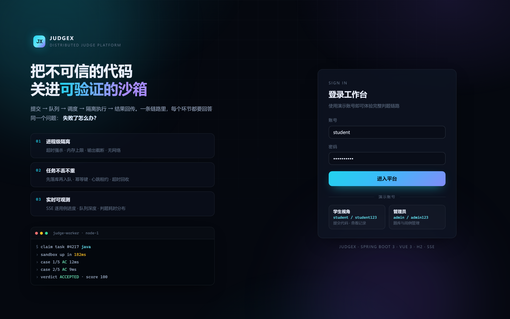

# JudgeX

一个能完整跑起来的在线判题系统。浏览器里写代码、提交，几秒内看到每个测试点的结果。

后端是 Spring Boot 单体 + 独立判题进程，前端 Vue 3，构建产物打进同一个 jar，单端口就能跑。

```
提交 → 落库 → 排队 → 调度（拉取 + 租约）→ 沙箱执行 → 逐用例回传（SSE）→ 落库
```

这个项目主要在处理两件事：不可信的代码怎么跑，以及机器中途挂掉时任务怎么不丢。下面的设计都围绕这两件事。

---

## 1. 快速开始

前置只有 JDK 17。不需要 MySQL，不需要 Docker；Redis 可选，有就用，没有自动降级到内存实现，功能不变。

```bash
cd backend
java -jar target/judgex-backend-1.0.0.jar
```

打开 <http://127.0.0.1:18900>，用演示账号登录：

| 账号 | 密码 | 角色 | 能做什么 |
| --- | --- | --- | --- |
| `student` | `student123` | 学生 | 做题、提交、看自己的记录 |
| `chen` | `student123` | 学生 | 同上（用来对比"全部提交"视图） |
| `admin` | `admin123` | 管理员 | 多一个「题库管理」：改题面、增删测试点 |

首次启动自动建库，写入 6 道题（A+B、字符串反转、最大子段和、斐波那契、括号匹配、第 K 大元素），每题 5 个测试点。数据在 `backend/data/`，删掉这个目录就重置。

前端不用单独起服务：构建产物随 jar 发布，`/api/*` 是接口，其余路径交给 Vue Router。

---

## 2. 界面



| 页面 | 路径 | 说明 |
| --- | --- | --- |
| 登录 | `/login` | 分屏落地页，演示账号一键填充 |
| 题库 | `/problems` | 6 题卡片、难度筛选、搜索、通过率条 |
| 做题 | `/problems/:id` | 左题面右编辑器，提交后逐用例实时出结果 |
| 提交记录 | `/submissions` | 我的/全部，抽屉里看每个用例的耗时、内存、输出和源码 |
| 运行监控 | `/dashboard` | 队列深度曲线、节点心跳、吞吐、语言运行时探测 |
| 题库管理 | `/admin` | 题目 CRUD + 测试点批量替换（仅 ADMIN） |


---

## 3. 几个设计决定

### 3.1 队列就是一张表

提交进来先写库：`submissions` 一行 `PENDING`，`judge_tasks` 一行 `QUEUED`，同一个事务。调度器每 250ms 从表里拉一批。

没把任务队列搬到 MQ，是因为任务状态机、租约、幂等键本来就在数据库里。队列换到别处，等于把"任务在哪、什么状态"拆成两个真相，故障时对账反而更麻烦。MQ 在这个项目里有别的用处，见 3.7。

### 3.2 认领是一条 CAS

```sql
UPDATE judge_tasks SET status='ASSIGNED', worker_id=?, attempts=attempts+1, version=version+1
WHERE id=? AND status='QUEUED' AND version=?
```

affected rows = 1 的那个 worker 拿到任务，其余空手而归。不用加锁，多实例也是安全的。

用例结果表在 `(submission_id, ordinal)` 上有唯一索引，重复写入直接被数据库挡住，不靠应用层去重。

### 3.3 worker 挂了，任务会被捡回来

worker 每 3 秒续一次租约（`lease_until = now + 45s`）。看门狗每 5 秒扫一遍过期的 `ASSIGNED` / `RUNNING` 任务：状态退回 `QUEUED`，`attempts + 1`；累计 3 次还是没跑完，任务进死信，提交判 `SYSTEM_ERROR` 并写明原因。

心跳同时写一份到 Redis（`SET EX 10`），监控页靠它显示节点在线；但租约本身在数据库里，Redis 挂了不影响回收。

### 3.4 沙箱先管住三件事

死循环、输出洪水、内存。

- **超时**：`Process.waitFor(timeout)`，到点 `destroyForcibly()`。Docker 模式下直接杀容器。
- **输出**：stdout / stderr 各一个读取线程，累计超过 64KB 立刻杀进程并判 `OLE`。不等管道写满才发现，否则子进程会假死在那里。
- **内存**：Java 加 `-Xmx256m -Xss64m`，Node 加 `--max-old-space-size=256`。Python 和 C++ 目前没有上限，这是 local 模式的已知缺口。

另外会把环境变量清空（只留 `PATH`），`HOME`、`TMPDIR` 指向任务自己的临时目录，跑完就删——省得提交的代码从环境变量里读出宿主机的东西。

`local` 是进程级隔离，能防误伤，防不住恶意代码读内存、扫内网、提权。要真隔离，起 Docker 后把 `JUDGEX_SANDBOX` 设成 `docker`，`DockerSandbox` 按同一套接口实现。

### 3.5 判题过程要看得见

每跑完一个用例推一条 SSE 事件，前端把 chip 逐个点亮，不用轮询。

断线重连先收一份 `snapshot`（当前全部结果），再收增量事件，所以中间丢几条也不会错位。

### 3.6 Redis 只放能重建的状态

Redis 在这里只承担三件事，三件都可以丢：

| 落点 | Key | 做法 | 挂了会怎样 |
| --- | --- | --- | --- |
| 提交限流 | `jx:rl:submit:{userId}` | Lua 脚本一次完成"取令牌 → 补令牌 → 写回 → 续期"，按每分钟上限匀速补充 | 退回进程内 60s 滑动窗口，单机语义一致 |
| Worker 存活 | `jx:worker:{workerId}` | `SET ... EX 10`，每 3 秒覆盖；在线列表用 `SCAN` | 退回数据库 `workers.last_heartbeat`，判题照跑 |
| 排行榜 | `jx:lb` | ZSET，`score = 通过题数*1e6 + (999999 - 总耗时ms)`，同分比谁快 | 返回空列表，不阻塞任何请求 |

题库没有做缓存：6 道题，详情是一次主键查询，没有热点，加一层缓存只会多一个失效点。

### 3.7 判题结果怎么送出去

判题完成和"发一条事件"必须当成同一个事实。否则只有两种结局：结果落库了、事件丢了，下游永远不知道；或者事件发出去了、事务回滚了，下游收到一条不存在的结果。

所以 `finish()` 在一个事务里做两件事：更新 `submissions`，往 `outbox` 插一行（`event_key = verdict:{submissionId}` 唯一索引兜底）。之后 `OutboxRelay` 每 400ms 扫一遍到期行，投到 RocketMQ：成功置 `SENT`，失败 `attempts+1` 并指数退避（1s → 2s → 4s，30s 封顶），6 次仍失败进 `DEAD` 等人工看。

消费端 `judgex-notify` 把事件落成站内通知，`notifications.submission_id` 唯一索引保证重复投递不会多出一条。

| 要保证的 | 靠什么 |
| --- | --- |
| 不丢 | 同一个本地事务写结果和事件 |
| 不重 | `outbox.event_key` 唯一索引 |
| 不阻塞 | relay 异步投递，broker 挂了事件留在表里 |
| 能追平 | 指数退避 + 租约回收（30s），恢复后自动补发 |

实测：停掉 broker 再提交，判题照常 AC，`outbox.pending` 变 1；重启 broker 后约 27 秒追平。整条判题链路没有一步在等 MQ。

---

## 4. 架构

```
┌──────────────┐   HTTP/JSON + SSE    ┌──────────────────────────────────┐
│  Vue 3 SPA   │ ───────────────────► │  Spring Boot (单进程, :18900)     │
│  Vite build  │ ◄─────────────────── │  ├ AuthFilter(JWT HS256)         │
└──────────────┘                      │  ├ SubmissionService (幂等键)     │
                                      │  ├ SchedulerService (拉取+租约)   │
                                      │  ├ JudgeEngine (编译/逐用例)      │
                                      │  └ ProgressHub (SSE fan-out)     │
                                      └───────┬──────────────┬───────────┘
                                              │              │
                                 ┌────────────▼───┐   ┌──────▼─────────┐
                                 │ H2 (file)      │   │ 沙箱            │
                                 │ 题目/提交/任务  │   │ local 进程      │
                                 │ /worker        │   │ 或 Docker       │
                                 └────────────────┘   └────────────────┘
                                 ┌────────────────┐
                                 │ Redis (可选)    │  限流·心跳·排行榜
                                 │ 挂了就降级      │  不存任务真相
                                 └────────────────┘
                                 ┌────────────────┐
                                 │ RocketMQ (自建) │  outbox → judgex-result
                                 │ :19877 / :10913│  消费端落站内通知
                                 └────────────────┘
```

没拆微服务。这个体量拆开，多两个进程、多几次网络往返，换不来实际收益。真正需要独立扩容的是判题节点：换 `JUDGEX_WORKER_ID` 就能起第二个 worker，互斥靠 3.2 那条 CAS。

更细的设计写在 [`docs/ARCHITECTURE.md`](docs/ARCHITECTURE.md)。

---

## 5. 接口

所有 `/api/**` 需要 `Authorization: Bearer <token>`；SSE 因为 `EventSource` 带不了 header，支持 `?token=`。

| 方法 | 路径 | 说明 |
| --- | --- | --- |
| POST | `/api/auth/login` | `{username, password}` → `{token, user}` |
| GET | `/api/auth/me` | 当前用户 |
| GET | `/api/problems` | 题目列表（含通过率、提交数） |
| GET | `/api/problems/{id}` | 题目详情（只返回可见样例） |
| POST | `/api/submissions` | 提交；`Idempotency-Key` 头可选，重复键返回同一条记录 |
| GET | `/api/submissions?mine=&problemId=&limit=` | 提交列表 |
| GET | `/api/submissions/{id}` | 提交详情（用例结果 + 源码 + 编译输出） |
| GET | `/api/submissions/{id}/events` | SSE：`snapshot` / `status` / `compiled` / `case` / `submission:done` |
| GET | `/api/dashboard` | 队列深度序列、节点、吞吐、语言探测 |
| GET | `/api/leaderboard` | 排行榜：通过题数 + 总耗时（Redis ZSET） |
| GET | `/api/presence` | 在线 worker（Redis 存活键）与 Redis 状态 |
| GET | `/api/mq/stats` | 发件箱统计：broker/consumer 状态、待投递/已投递/死信 |
| GET | `/api/notifications?mine=&limit=` | 消费端产出的站内通知 |
| GET | `/api/workers` | 节点心跳与占用 |
| GET | `/api/languages` | 可用语言 |
| GET | `/api/health` | 健康检查（免鉴权） |
| POST/PUT/DELETE | `/api/admin/problems[/{id}]` | 题目维护（ADMIN） |
| PUT | `/api/admin/problems/{id}/cases` | 整组替换测试点（ADMIN） |

---

## 6. 配置

都可以用环境变量覆盖，默认值在 `backend/src/main/resources/application.yml`：

| 变量 | 默认 | 说明 |
| --- | --- | --- |
| `JUDGEX_PORT` | `18900` | 服务端口（本机 8080/3306/6379/13306/16379/18080 被别的项目占着，所以避开） |
| `JUDGEX_SANDBOX` | `local` | `local` \| `docker` \| `auto` |
| `JUDGEX_REDIS_ENABLED` | `true` | 关掉走纯内存/数据库实现，功能不变 |
| `JUDGEX_REDIS_HOST` / `PORT` | `127.0.0.1` / `6379` | 连不上进入 5s 降级窗口，不阻塞请求 |
| `JUDGEX_MQ_ENABLED` | `true` | 关掉则不投递，事件留在 outbox 里（判题不受影响） |
| `JUDGEX_MQ_NAMESRV` | `127.0.0.1:19877` | 本机自建的 nameserver，见 `docker/rocketmq/` |
| `JUDGEX_WORKER_ID` | `node-1` | 节点标识 |
| `JUDGEX_WORKER_CONCURRENCY` | `4` | 并行判题槽位 |
| `JUDGEX_JWT_SECRET` | 开发用默认值 | 上线必须换 |

## 7. 从源码构建

在离线环境验证过，Maven 要指向本地仓库：

```bash
# 前端
cd frontend
node node_modules/vite/bin/vite.js build      # 产物在 dist/

# 把产物塞进后端静态目录
cd ../backend
rm -rf src/main/resources/static && mkdir -p src/main/resources/static
cp -r ../frontend/dist/. src/main/resources/static/

# 后端（离线 + 跳过 aether 锁文件）
/path/to/mvn -o -B -DskipTests -Daether.syncContext.named.factory=noop package
java -jar target/judgex-backend-1.0.0.jar
```

打包前记得先停掉正在运行的 jar，Windows 上文件被占用会 rename 失败。

## 8. 已知边界

- `local` 沙箱是进程级隔离：能防住超时、输出洪水、误写文件，防不住恶意代码读内存、扫内网、提权。生产要切 `docker`。
- local 模式下只有 Java 和 Node 设了内存上限，Python / C++ 没有；内存用量也拿不到准确值，页面上显示 `—` 而不是编一个。
- H2 单文件库适合演示和单机部署。换 MySQL 只改 datasource 和方言，SQL 里没有 H2 专有语法。
- 调度是单节点扫表。多节点部署时 CAS 本身仍然安全，但回收扫描会重复，换成 `SKIP LOCKED` 或租约表更合适。
- 限流是按用户的，不是全局的。多实例时靠 Redis 版本共享配额，内存回退版只在单机准确。
- 排行榜只算"通过题数 + 最快 AC 总耗时"，没有赛季、分段、冻结榜。改排名规则只动 `LeaderboardService` 一处。
- 站内通知只是落库，没有发邮件/短信的通道。
